  

  
  
  

## 🧑‍💻 Sobre mim

Sou engenheiro de software com **mais de 5 anos** construindo sistemas de ponta a ponta, do backend à interface, em domínios onde **erro custa caro**: assinatura eletrônica com validade jurídica, cartões e crédito, investimentos e logística.

Trabalho principalmente com **microsserviços e APIs REST em Java/Spring Boot, .NET/C# e Go**, rodando em **Kubernetes** na **GCP e AWS**. Aplico **Clean Architecture, DDD, SOLID e Design Patterns** e costumo atuar perto de produto e negócio para transformar necessidades em soluções escaláveis.

  

## 🛠️ Stack

<table>
  <tr>
    <td><b>Backend</b></td>
    <td> Spring Security · Spring Data JPA · Quarkus · Hibernate · ASP.NET Core · Entity Framework · Maven · Gradle</td>
  </tr>
  <tr>
    <td><b>Frontend</b></td>
    <td> React Native</td>
  </tr>
  <tr>
    <td><b>Cloud e DevOps</b></td>
    <td> GKE · EKS · ECS · EC2 · RDS · SQS · SonarQube · Dynatrace</td>
  </tr>
  <tr>
    <td><b>Dados</b></td>
    <td> SQL Server · SQL avançado</td>
  </tr>
</table>

## 💼 Experiência

  

<b>Ver detalhes de cada experiência</b>

**Certisign** — Desenvolvedor Fullstack · *jan/2026 – atual*  
Plataforma de assinatura eletrônica e certificação digital. Desenho e evolução de APIs e microsserviços em .NET/C# e Java/Spring Boot, frontends em Next.js/React, deploy na GCP e observabilidade com Dynatrace. Também participo de code reviews e da definição de padrões de desenvolvimento. 🏆 1º lugar no primeiro Hackathon da empresa.

**FictorPay** — Desenvolvedor Fullstack · *fev/2024 – jan/2026*  
Plataforma de meios de pagamento (cartões e crédito). Microsserviços em Java (Spring Boot e Quarkus), Go e C#, integração com adquirentes como Cielo e Phoebus, modernização de legados para arquitetura distribuída, Kubernetes na AWS e GCP, e evolução das pipelines de CI/CD.

**Grupo Fictor** — Desenvolvedor Fullstack · *fev/2024 – abr/2025*  
Sistemas de investimentos e private equity. APIs em Java/Spring Boot, C#/ASP.NET e Node.js, modernização de legados com DDD e automação de processos internos.

**Exudus Tech** — Desenvolvedor Fullstack · *nov/2023 – fev/2024*  
Automações e robôs com Node.js e Python, web scraping e integrações com APIs corporativas.

**LinkedBy** — Desenvolvedor Fullstack · *fev/2022 – nov/2023*  
WMS para galpões e centros de distribuição com ASP.NET Core, Entity Framework e SQL Server: novas funcionalidades, integrações e otimização de consultas.

**Flimed** — Desenvolvedor Fullstack · *jan/2021 – mar/2022*  
Aplicações web e mobile de telemedicina com React, React Native e APIs em Node.js.

## 🎓 Formação e certificações

- **Análise e Desenvolvimento de Sistemas** — Universidade Anhembi Morumbi
- **Sistemas de Informação** — Universidade Federal do Ceará (UFC)
- **Matemática** — UNINTER (em andamento)
- **Certificações:** PSPO I (Professional Scrum Product Owner) · Software Engineering · SQL (Advanced) · JavaScript (Intermediate)

## 📂 Projetos pessoais

  
  
  
  

A maior parte do meu trabalho profissional fica em repositórios privados das empresas. Os projetos acima são estudos e experimentos pessoais.

