<picture>
  <source media="(prefers-color-scheme: dark)" srcset="assets/banner-dark.svg">
  
</picture>

  <a href="https://www.linkedin.com/in/rodrigo-coelho-4b3a3b1ab/"><b>LinkedIn</b></a>
  &nbsp;&nbsp;·&nbsp;&nbsp;
  <a href="mailto:rodrigocoelho236@gmail.com"><b>E-mail</b></a>
  &nbsp;&nbsp;·&nbsp;&nbsp;
  <a href="https://rodrigoscoelho.vercel.app/"><b>Portfólio</b></a>

 

  Construo sistemas de ponta a ponta em domínios onde erro custa caro: documentos com validade jurídica, 
  transações financeiras e operações logísticas. Microsserviços e APIs REST em Java, .NET e Go, 
  rodando em Kubernetes na GCP e AWS, com Clean Architecture, DDD e SOLID.

 

<picture>
  <source media="(prefers-color-scheme: dark)" srcset="assets/highlights-dark.svg">
  
</picture>

  

<picture>
  <source media="(prefers-color-scheme: dark)" srcset="assets/stack-dark.svg">
  
</picture>

  

<picture>
  <source media="(prefers-color-scheme: dark)" srcset="assets/timeline-dark.svg">
  
</picture>

  

  FORMAÇÃO 
  Análise e Desenvolvimento de Sistemas — Anhembi Morumbi 
  Sistemas de Informação — UFC &nbsp;·&nbsp; Matemática — UNINTER (em andamento)

  CERTIFICAÇÕES 
  PSPO I &nbsp;·&nbsp; Software Engineering &nbsp;·&nbsp; SQL (Advanced) &nbsp;·&nbsp; JavaScript (Intermediate)

  PROJETOS PESSOAIS 
  <a href="https://github.com/Rozdrigo/PaymentAPI">PaymentAPI</a> &nbsp;·&nbsp;
  <a href="https://github.com/Rozdrigo/knex_masterclass">knex_masterclass</a> &nbsp;·&nbsp;
  <a href="https://github.com/Rozdrigo/trends__br">trends__br</a> &nbsp;·&nbsp;
  <a href="https://github.com/Rozdrigo/fractal_tree">fractal_tree</a>

